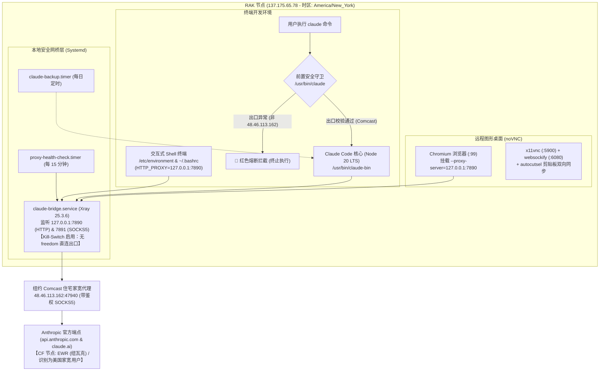

# 工程交接文档 (Engineering Handoff Document)

> **任务主题**：RAK 节点 Claude Code 美国家宽代理与五重防封安全防护体系  
> **交接日期**：2026-10-04  
> **目标服务器**：RAK-Bulk-1T (`ssh -p 28827 root@137.175.65.78`)  
> **核心出口**：美国纽约 Comcast 住宅家庭宽带 (`48.46.113.162:47940`)  

---

## 1. 业务背景与交付目标

为在海外 VPS 上直接使用 Claude Code（CLI 与自动化浏览器）并保障订阅账号资产安全，必须彻底解决机房托管 IP（Hosting/DataCenter ASN）带来的风控封禁风险（如 `Organization disabled` 或 403 阻断）。

本次交付在 RAK 节点上完整搭建了**本地安全网桥 + Kill-Switch 硬件级防裸连熔断 + 前置守卫 + 五重防封安全防护体系**，实现：
1. **全链路伪装**：终端命令、Claude Code CLI、VNC Chromium 浏览器对外表现为纯正美国纽约 Comcast 住宅家宽。
2. **零泄漏保障**：一旦家宽代理断线，网络直接报错熔断，**坚决不回退到机房直连**，杜绝机房 IP 裸连泄露。
3. **流量边界隔离**：DMIT 专线、RAK 1000G 大流量泄洪与家宽专线严格解耦，互不干扰，不浪费家宽额度。

---

## 2. 完整系统拓扑与数据流向



---

## 3. 五重防封安全防护体系详解

| 防护层级 | 核心机制 | 落地文件 / 守护进程 | 达成的安全指标 |
| :--- | :--- | :--- | :--- |
| **第一重：终端环境全局家宽化** | 全局固化代理变量，Git 与 npm 默认直通网桥 | `/etc/environment`<br>`/root/.bashrc` | 终端执行任何 `curl`、`git`、`npm` 命令，**默认 100% 走家宽**，消除裸连疑虑 |
| **第二重：系统指纹与时区对齐** | 系统时区全面对齐美东纽约时区 | `America/New_York`<br>(EDT, UTC-4) | 系统时钟、Node.js 时间戳与纽约宽带物理环境一致，消除“时空错位”风控 |
| **第三重：网桥远端 DNS 强制解析** | 域名解析策略设置为 `AsIs`，交由 SOCKS5 远端执行 | `/etc/claude-bridge/config.json` | 本地机房无任何 Anthropic 域名解析痕迹，**杜绝 DNS 泄漏** |
| **第四重：OAuth 闭环与 Token 冷备份** | 免复制打开授权链接，每日增量备份会话凭据 | `chrome-open`<br>`claude-backup.timer` | 授权与调用从始至终同 IP；遇故障可一键 `claude-session-restore` 免登录恢复 |
| **第五重：可用性探针与硬核 Kill-Switch** | 每 15 分钟自动化探活，网桥彻底剔除 freedom 出口 | `proxy-health-check.timer`<br>`claude-bridge.service` | 上游家宽一旦故障，连接立即拒连报错，**绝不回退到机房直连，杜绝意外漏网** |

---

## 4. 关键服务与资产清单

### 4.1 核心服务（Systemd）
* **`claude-bridge.service`**：本地安全网桥服务，监听 `127.0.0.1:7890`（HTTP）与 `127.0.0.1:7891`（SOCKS5）。
* **`claude-backup.timer`**：每日触发，自动归档 `~/.claude*` 至 `/root/.claude-backups/`。
* **`proxy-health-check.timer`**：每 15 分钟触发一次家宽可用性探针。

### 4.2 运维助手工具
| 工具路径 | 使用方式 | 作用与场景 |
| :--- | :--- | :--- |
| `/usr/bin/claude` | `claude` | 前置守卫启动脚本，毫秒级校验出口，通过后方启动真实 CLI |
| `/usr/bin/claude-bin` | - | 真正的 Claude Code 二进制（Node 20 LTS 驱动） |
| `/usr/local/bin/chrome-open` | `chrome-open "<URL>"` | 在 VNC Chrome 浏览器中免复制直接新建标签页打开（OAuth 授权专用） |
| `/usr/local/bin/vnc-clip` | `vnc-clip "<文本>"` | 将字符串或管道内容推送至远程 X11 与 Chrome 剪贴板 |
| `/usr/local/bin/claude-session-backup` | 手动执行备份 | 生成时间戳增量备份包并更新 latest 软链接 |
| `/usr/local/bin/claude-session-restore` | 手动执行恢复 | 从 latest 冷备份快速还原 Claude 凭据 |
| `/usr/local/bin/proxy-health-check` | 手动执行探针 | 输出当前家宽代理的连通性、出口 IP 与运营商状态 |
| `/root/claude-signup/launch.sh` | 一键自愈桌面 | 一站式拉起 Xvfb、autocutsel、x11vnc、websockify 与挂载家宽的 Chrome |

---

## 5. 快速上手与日常运维指令

### 5.1 登录服务器
```bash
ssh -p 28827 root@137.175.65.78
```

### 5.2 启动 Claude Code
```bash
claude
```

### 5.3 首次 OAuth 授权登录最佳实践
1. 在本地电脑开启隧道映射：
   ```bash
   ssh -p 28827 -L 6080:127.0.0.1:6080 root@137.175.65.78
   ```
2. 本地浏览器打开 `http://localhost:6080/vnc.html`，点击 **Connect** 按钮（已配置免密）。
3. 在 RAK 终端执行 `claude login`，将生成的链接通过助手工具一键送入 Chrome：
   ```bash
   chrome-open "https://accounts.anthropic.com/oauth/authorize?..."
   ```
4. 在 VNC Chrome 界面中点击确认授权，登录流程全链路在同一个家宽 IP 下闭环完成。

### 5.4 状态检查指令
```bash
# 1. 验证终端默认出口 IP (应直接输出 Comcast 48.46.113.162)
curl -s https://ipinfo.io/json

# 2. 检查系统时区 (应为 America/New_York)
timedatectl status

# 3. 检查 Anthropic 连通性 (应返回 HTTP/2 404，无 Cloudflare 403)
curl -s -I https://api.anthropic.com

# 4. 查看家宽健康探针状态
cat /var/run/claude-proxy-status

# 5. 查看本地网桥实时流量
journalctl -u claude-bridge -f
```

---

## 6. 后续 Agent 接手注意事项 (Strict Guidelines)

1. **绝对禁止在网桥中添加直连出站 (`freedom`)**：
   `/etc/claude-bridge/config.json` 中的 `outbounds` 只能包含家宽代理出站与黑洞出站（Kill-Switch 规则），严禁因调试目的添加直连，防止在代理网络抖动时导致真实机房 IP 泄漏给 Anthropic。
2. **关于 SSH 与主控反向隧道的自愈保护**：
   SSH（端口 `28827`）和 Marzban 主控反向隧道（端口 `62050/62051`）监听在独立的公网/回环网卡上，不受 HTTP 代理环境变量影响。维护网络时切勿修改全局 iptables 默认 DROP 规则，以防自断通信。
3. **家宽代理账号更换流水线**：
   若未来更换家宽代理凭据，只需更新 `/etc/claude-bridge/config.json` 中的 `servers` 字段（IP、端口、账号、密码），随后执行 `systemctl restart claude-bridge` 即可，上层所有服务和脚本无感继承。
