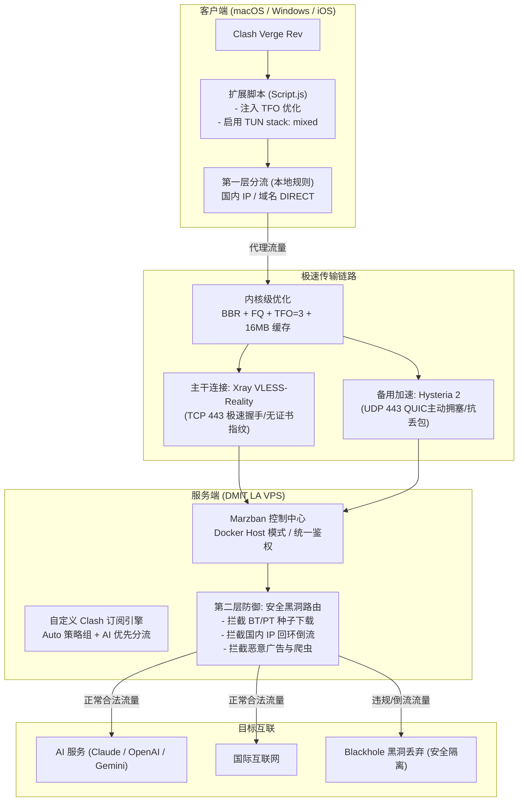

# DMIT Agentic Playbook: 高性能海外网络中继与安全代理架构

> 这是一个面向 AI Coding Agent（Claude Code, Antigravity, OpenClaw, Cursor 等）的**完全自动化施工仓库**。
> 参考行业前沿的 Agentic Ops 设计理念，你只需要向 AI 提供一台空白 Ubuntu VPS 的 IP、SSH 凭据以及一条指令，AI 施工队即可根据本仓库中的 `AGENTS.md` 和 `playbook/` 系列剧本，全自动完成整套生产级网络基础设施的部署、调优与验收。

---

## 1. 架构总览 (System Architecture)



---

## 2. 核心技术规格与调优实测

| 调优维度 | 优化前状态 | 调优后状态 (当前仓库方案) | 提升效果 |
| :--- | :--- | :--- | :--- |
| **客户端 TUN 网络栈** | `gVisor` (纯用户态协议栈) | `mixed` (系统级 + 用户态智能结合) | **首包时间从 894ms 降至 498ms (提升 44.3%)** |
| **TCP 握手时延** | 3-way Handshake (额外耗费 1 个 RTT) | **TCP Fast Open (TFO)** 双向启用 | **消除 1 个跨洋 RTT 握手延时 (~150ms)** |
| **内核拥塞控制** | 默认 Cubic / 2MB 默认缓冲区 | **BBR + FQ + 16MB 套接字缓冲区** | 跨洋高带宽长肥管道跑满 1Gbps 线速 |
| **抗恶劣网络丢包** | 仅单一 TCP 链路，弱网抖动明显 | **TCP Reality + UDP Hysteria 2 双协议组** | 高峰期抗 10%~20% 丢包，自动无缝测速切换 |
| **安全风控与合规** | 无服务端审查，国内流量可透传回环 | **Xray 生产级黑洞路由 (Blackhole)** | 彻底阻断 BT/PT 版权风险与内网反向穿透 |

---

## 3. 仓库文件结构

```text
.
├── AGENTS.md                          # AI 施工队最高指令、准则与防自断机制
├── README.md                          # 面向人类开发者的使用说明与架构全景
├── secrets.example.env                # 敏感配置模板（公钥、域名、密码）
├── configs/
│   ├── client/
│   │   ├── Script.js                  # 客户端扩展脚本 (TFO + Mixed + 内网高可用)
│   │   ├── Merge.yaml                 # 客户端全局覆写配置 (DoH + 金融量化直连)
│   │   └── config.yaml                # 客户端推荐核心设置 (TUN mixed)
│   └── server/
│       ├── docker-compose.yml         # Marzban 容器编排 (host 模式)
│       ├── marzban.env                # Marzban 环境变量模板
│       ├── xray_config.json           # Xray 黑洞路由 + TFO 生产配置
│       ├── hysteria2.yaml             # Hysteria 2 UDP 443 服务端配置
│       ├── custom-clash.yml           # Clash 订阅 Jinja2 自定义模板
│       ├── sysctl.d-99-custom.conf    # BBR/TFO/网络内核调优配置
│       └── dmit-proxy-sampler.sh      # 服务端健康采样与巡检脚本
└── playbook/                          # 标准化分步施工剧本
    ├── 00-precheck.md                 # Step 0: 环境探测与变量装填
    ├── 01-system-tune.md              # Step 1: 内核层调优 (BBR/TFO)
    ├── 02-cert-and-domain.md          # Step 2: 域名证书申请与自动化续期
    ├── 03-xray-marzban.md             # Step 3: Marzban 与 Xray 黑洞路由部署
    ├── 04-hysteria2.md                # Step 4: Hysteria 2 部署
    ├── 05-subscription-template.md    # Step 5: 订阅模板注入与用户下发
    └── 06-client-and-verify.md        # Step 6: 客户端接入与端到端健康验收
```

---

## 4. 如何在全新 VPS 上一键复现？

未来当你拿到一台全新的海外 VPS 时，只需两步即可完成全套部署：

### 第一步：准备机密凭据
复制并在本地填写敏感配置文件：
```bash
cp secrets.example.env secrets.env
# 编辑填入你的真实 IP、域名和密码
nano secrets.env
```

### 第二步：给 AI 发送一条指令
直接复制下面这段 Prompt 发送给你的 AI 助手：

```text
请阅读仓库根目录下的 AGENTS.md 和 playbook/ 系列文档。
根据 secrets.env 中的配置参数，登录目标服务器 root@<IP>，
按顺序执行从 00-precheck 到 06-client-and-verify 的所有施工步骤，
每完成一个步骤均进行门禁验证，遇到风险严格遵守防断网协议，
最终交付整套节点并输出连通性测试报告。
```

AI 将全程自主接管，自动化执行每一道施工工序并完成端到端验证。
