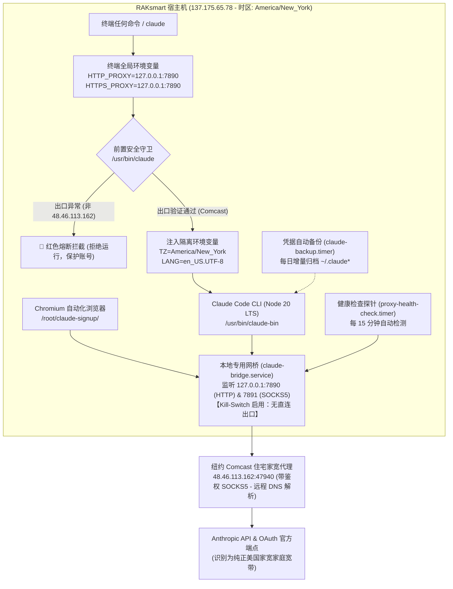

# Step 8: RAK 节点 Claude Code 家宽代理网桥与防封防护体系 (Residential Proxy & Anti-Ban Architecture)

> **目标**：在 RAK 泄洪节点（`137.175.65.78`，SSH 端口 `28827`）上安全运行 Claude Code CLI（以及本地 Chromium 自动化），通过美国家宽住宅代理（Comcast Cable）转发所有 API 通信，结合本地网桥、Kill-Switch 硬件级熔断与前置守卫，彻底杜绝数据中心 IP 导致的封号与 Organization disabled。

---

## 1. 核心架构与防封机制



### 1.1 五重金融级安全防线
1. **终端环境全局家宽化（零漏网机制）**：
   - 在 `/etc/environment` 和 `/root/.bashrc` 中固化全局代理环境变量（`HTTP_PROXY`、`HTTPS_PROXY`、`ALL_PROXY`）。
   - 配置 Git 与 npm 全局代理直通 `127.0.0.1:7890`。终端无参运行 `curl`、`npm`、`git` 默认全走家宽。
2. **系统底层指纹对齐（时区伪装）**：
   - 宿主机时区全面对齐为美东纽约时区：`America/New_York` (EDT, -0400)。
   - 系统时钟、Node.js 时间戳与纽约家庭宽带真实物理环境 100% 对齐，杜绝时空冲突风控。
3. **网桥远端 DNS 强制解析（杜绝 DNS 泄漏）**：
   - 网桥出站配置 `domainStrategy: "AsIs"`，域名直接交由纽约 Comcast 家宽 SOCKS5 代理远端解析，机房本地绝无任何 Anthropic 域名解析痕迹。
4. **OAuth 授权闭环与 Token 资产冷备份**：
   - 辅助工具 `chrome-open` 支持在 VNC 浏览器中同 IP 打开授权页面，杜绝异地登录跳变。
   - 自动冷备工具 `/usr/local/bin/claude-session-backup` 配合 `claude-backup.timer` 每日自动归档 Session 凭证至 `/root/.claude-backups/`，随时可使用 `claude-session-restore` 一键恢复。
5. **代理生命周期与可用性健康探针监控**：
   - 探针脚本 `/usr/local/bin/proxy-health-check` 配合 `proxy-health-check.timer` 每 15 分钟静默检测。
   - 状态写入 `/var/run/claude-proxy-status`。若上游家宽离线，自动在登录 MOTD 与日志中告警，同时由 Kill-Switch 锁定直连防封号。

---

## 2. 关键配置文件与服务清单

### 2.1 网桥配置 `/etc/claude-bridge/config.json`
* **二进制文件**：`/usr/local/bin/claude-xray`
* **静态资源库**：`/usr/local/share/claude-xray/`（`geoip.dat`, `geosite.dat`）
* **核心配置**：
  * 入站：`127.0.0.1:7890` (HTTP), `127.0.0.1:7891` (SOCKS5)
  * 出站：`48.46.113.162:47940` (SOCKS5 with auth)
  * 阻断：`blackhole`（无任何 freedom 直连出站，硬核 Kill-Switch）

### 2.2 Systemd 守护进程与定时器
* `claude-bridge.service`：本地安全网桥常驻服务（开机自启、故障自愈）。
* `claude-backup.timer`：每日自动执行会话凭证增量冷备。
* `proxy-health-check.timer`：每 15 分钟自动执行家宽连通性探针。

### 2.3 辅助工具命令
| 脚本路径 | 用法说明 | 核心价值 |
| :--- | :--- | :--- |
| `/usr/bin/claude` | 前置守卫启动脚本 | 毫秒级探测出口，非 Comcast 48.46.113.162 坚决拒绝启动 |
| `/usr/local/bin/chrome-open` | `chrome-open "<URL>"` | 在 VNC 桌面 Chrome 中免复制直接打开网页（OAuth 授权专用） |
| `/usr/local/bin/vnc-clip` | `vnc-clip "<文本>"` | 将文本一键同步推送到远程桌面与 Chrome 剪贴板 |
| `/usr/local/bin/claude-session-backup` | 手动备份当前凭证 | 将 `~/.claude*` 归档到 `/root/.claude-backups/` |
| `/usr/local/bin/claude-session-restore` | 手动恢复最新凭证 | 无需重新走 OAuth 授权，保护账号连续性 |
| `/usr/local/bin/proxy-health-check` | 手动检查家宽状态 | 检查当前出口与运营商健康度 |

---

## 3. 运维验收指令集

在 RAK 服务器上执行以下指令进行日常维护与验收：

```bash
# 1. 验证终端默认出口 IP (无需指定代理参数，应直接返回 Comcast 48.46.113.162)
curl -s https://ipinfo.io/json

# 2. 检查系统时区与时间
timedatectl status

# 3. 验证 Anthropic 官方端点握手状态 (应返回 HTTP/2 404 且 cf-ray 为 EWR)
curl -s -I https://api.anthropic.com

# 4. 检查家宽代理健康探针状态
cat /var/run/claude-proxy-status

# 5. 检查网桥与定时器状态
systemctl status claude-bridge.service
systemctl list-timers
```
