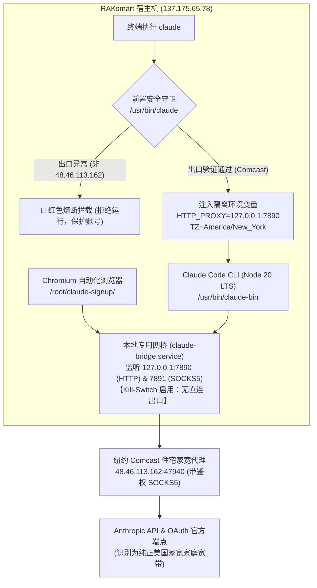

# Step 8: RAK 节点 Claude Code 家宽代理网桥与防封防护体系 (Residential Proxy & Anti-Ban Architecture)

> **目标**：在 RAK 泄洪节点（`137.175.65.78`，SSH 端口 `28827`）上安全运行 Claude Code CLI（以及本地 Chromium 自动化），通过美国家宽住宅代理（Comcast Cable）转发所有 API 通信，结合本地网桥、Kill-Switch 硬件级熔断与前置守卫，彻底杜绝数据中心 IP 导致的封号与 Organization disabled。

---

## 1. 核心架构与防封机制



### 1.1 三重安全防线
1. **本地常驻网桥（Local Bridge）**：
   - 服务名称：`claude-bridge.service`，监听 `127.0.0.1:7890`（HTTP）与 `127.0.0.1:7891`（SOCKS5）。
   - 彻底解决 Node.js / CLI 工具对带密码 SOCKS5 代理的语法与认证解析 Bug。
2. **防泄漏硬熔断（Kill-Switch）**：
   - 网桥出站配置中**彻底移除机房直连（freedom 协议）**，仅配置家宽 SOCKS5 出站与 Blackhole 黑洞。
   - 若家宽代理离线，请求直接拒绝报错，**绝对杜绝机房 IP 裸连回退泄漏**。
3. **前置守卫启动器（Pre-flight Guard）**：
   - 封装 `/usr/bin/claude`，启动前自动执行探测。
   - 严格匹配当前出口是否为 `48.46.113.162` 且 ISP 包含 `Comcast`，验证通过才放行启动真实二进制 `/usr/bin/claude-bin`。

---

## 2. 关键配置文件与服务

### 2.1 网桥配置 `/etc/claude-bridge/config.json`
* **二进制文件**：`/usr/local/bin/claude-xray`
* **静态资源库**：`/usr/local/share/claude-xray/`（`geoip.dat`, `geosite.dat`）
* **核心配置**：
  * 入站：`127.0.0.1:7890` (HTTP), `127.0.0.1:7891` (SOCKS5)
  * 出站：`48.46.113.162:47940` (SOCKS5 with auth)

### 2.2 Systemd 守护进程 `/etc/systemd/system/claude-bridge.service`
```ini
[Unit]
Description=Claude Code Local Residential Proxy Bridge (Kill-Switch Enabled)
After=network.target

[Service]
Type=simple
User=root
Environment=XRAY_LOCATION_ASSET=/usr/local/share/claude-xray
ExecStart=/usr/local/bin/claude-xray run -config /etc/claude-bridge/config.json
Restart=always
RestartSec=3
LimitNOFILE=65535

[Install]
WantedBy=multi-user.target
```

### 2.3 前置守卫启动脚本 `/usr/bin/claude`
* 真实 Claude Code 二进制位于 `/usr/bin/claude-bin`。
* `/usr/bin/claude` 作为守卫脚本，负责：
  1. 检查并按需拉起 `claude-bridge.service`。
  2. 探测 `https://ipinfo.io/json`，比对 IP 与 Org。
  3. 注入 `HTTP_PROXY`, `HTTPS_PROXY`, `ALL_PROXY`, `TZ="America/New_York"`。
  4. 通过 `exec /usr/bin/claude-bin "$@"` 无感替换进程。

### 2.4 本地自动化浏览器配置
* 文件位置：`/root/claude-signup/launch.sh`
* 启动参数追加：`--proxy-server="http://127.0.0.1:7890"`
* 确保虚拟桌面 Chrome 发起的所有页面与网络请求同步走美国家宽。

---

## 3. 运维排错与验证指令

在 RAK 服务器上执行以下指令进行日常维护与验收：

```bash
# 1. 检查网桥运行状态
systemctl status claude-bridge.service

# 2. 验证出口 IP 是否为 Comcast 纽约家宽
curl -s -m 10 -x http://127.0.0.1:7890 https://ipinfo.io/json

# 3. 验证 Anthropic 官方端点握手状态 (应返回 HTTP/2 404 且 cf-ray 为 EWR)
curl -s -m 10 -x http://127.0.0.1:7890 -I https://api.anthropic.com

# 4. 查看网桥实时转发日志
journalctl -u claude-bridge -f

# 5. 启动 Claude Code
claude
```
